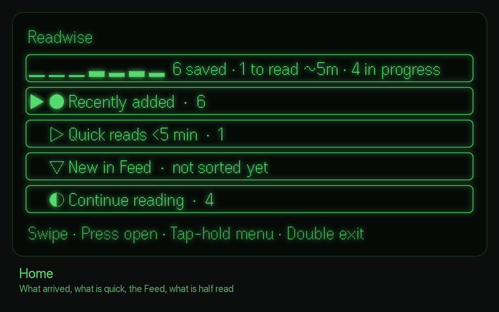

# Readwise for Even Realities G2

Your Readwise Reader library on Even Realities G2 smart glasses, and on the
phone. Browse what arrived, decide from a preview, ask for an AI summary only
when you want one, read the whole piece, and archive with one hold.

An independent, open-source app by a long-time Readwise user. Not made by or
affiliated with Readwise, Anthropic or Even Realities. MIT licensed.

- **Showcase:** [`docs/assets/showcase`](docs/assets/showcase) (walkthrough GIF, screens)
- **Privacy policy:** https://antonmogul.github.io/readwise-g2/store/privacy.html
- **Terms of use:** https://antonmogul.github.io/readwise-g2/store/terms.html
- **AI:** optional, with your own Claude API key. Readwise's Ghostreader is not
  available through the Readwise API, so the app brings its own.



## Why

I have used Readwise for years, and my saved-for-later list grew faster than I
could ever sit down and read it. This takes the library on the road.

The library has outgrown the ability to browse it: 1,014 items in `later`, 10,000
in `feed`. So this is not "Readwise on your face". It is a **way in** — decide
what to read, get the gist, and *then*, if you choose to, read it.

```
Context menu  →  Section  →  Article  →  (opt in)  Full scroll
                                 │   ↑______ hold: archive & next ______|
                                 └─ menu: Summarise (opt in)
```

Summaries and Feed sorting come from **the reader's own Claude API key**,
added in the phone's Settings with a choice of model (Opus 5.5, Sonnet 5.5,
Haiku 5.5). The app calls Anthropic directly from the webview — no server in
between, nothing to set up beyond the key — and each summary is cached forever,
so it is paid for once. Without a key, the public build offers no summaries; a
personal build with a Brain board (below) uses the board instead.

An article opens on a free preview — the publisher's blurb, or the article's
opening — never on a summary nobody asked for. A summary is a Claude turn, so it is asked for from the menu (the phone has a button),
and then cached forever. Until 2026-11-19 every open asked, and swiping through
a list started a Claude session per row.

Every transition is deliberate, and Feed does no work until it is selected.
The one thing that opens without a press is the next article after an
archive: the hold that archived was the request to move on.

## Two apps

`npm run pack` builds the public **Readwise** app for anyone with a Readwise
account: AI only through the reader's own Claude key, no voice Ask, no
microphone. `npm run pack:private` builds a personal variant that also talks
to a **Brain board**, a backend of your own on your tailnet, for voice Ask and
library search. Its address lives in an untracked `.env.private`; see CLAUDE.md.

## The four ways in (glasses)

| View | What it shows | Why |
|---|---|---|
| **Recent** | Newest saves | A predictable way back into the library |
| **Continue** | `0.05 < progress < 0.95` | Resume active reading |
| **Feed picks** | Recent RSS, newsletters, and articles | A bounded, on-demand digest; publication groups if the Brain is unavailable |
| **Surprise me** | Random unread from `later` | Defeats the 1,014-item paralysis by removing the choice |

Home is five equal tile slots: a one-line dashboard (a week of saves as bars,
the queue, what is in progress), then a marked door per section — `● Recently
added`, `▷ Quick reads`, `▽ New in Feed`, `◐ Continue reading`, `■ Long reads`,
`○ Surprise me`, `◎ Ask your library`. The dashboard scrolls away like a row; a
door with nothing behind it goes quiet and says `none right now`. The focused
row carries a `▶` cursor at full brightness; a swipe moves it in place with
`textContainerUpgrade` rather than rebuilding the page, so nothing flickers.

The Even OS contextual menu (tap the temple, then hold) carries `Ask your
library` and `Refresh library` everywhere, and on every screen but Home the
sections too, named exactly as their Home rows. On article screens, `Read
article`/`Show summary`, `Archive & next` and `Back` come first — after
`Summarise with Brain`, on an article that has no summary yet. A double tap
moves up one level, and exits through the system dialog only from Home.

## Reading (glasses)

The summary and the article are each **one full-bleed text container** —
no header, no footer, no framed rows. The title and one line of context
(publication · author · length · saved date) sit at the top of the text and
scroll away with it.

| Gesture | Summary | Article |
|---|---|---|
| Swipe | Scroll a line (the firmware does it) | Scroll a line |
| Swipe past the end | Next sheet, if the gist runs long | Next sheet, position saved on the device |
| Press | Open the article where you left it | Back to the summary |
| **Hold** | **Archive, open the next article** | **Archive, open the next article** |
| Double | Back to the list | Back to the list |

Every footer and closing line uses one grammar — gesture, then verb:
`Swipe · Press open · Tap-hold menu · Double back`; `▶ Press read · Hold
archive & next`. An empty list says where Press goes instead (`Press Recently
added`).

Every sheet after the first opens with one line of context — the title and a
progress bar, `The grid cannot carry the data…  ━━━━──── 54%` — and ends with
`▼ ━━━━━─── 61%` when more follows (the firmware's scrollbar only knows about
the sheet on screen) or `■ End · Hold archive & next` on the last one. Swiping
past the end of the last sheet records the article as finished — on the device:
Readwise's `reading_progress` cannot be written through its API (see below).

Hold archives straight away — Readwise's Archive, not a delete — and the next
summary opens with `■ Previous article archived` above its title (`□` while it
is pending, `○` if it failed; a tick is not in the firmware font). At the end of a
list it goes back to the list; from a Feed section, the digest's picks are
refilled the next time the digest is on screen, not while you read on.

The article page says whose words it shows: `From the publisher · Tap-hold
summarise` or `Opening · Tap-hold summarise`, then `□ Brain summarising…` once
asked. Press opens the reader while the summary is still being written; it
lands on the article page, and a failure says `○ Brain unavailable` and leaves
the offer in the menu to retry.

## Asking your library (glasses)

Press on Home — or choose **Ask your library** from the contextual menu on any
screen — and say what you want: *"something short about cities"*, *"what have
I read about sleep?"*. It sends when you pause (or press); double cancels.

```
● Listening → "your words, as heard" · Searching… → the answer → Press: open these
```

The answer names the documents it draws on; Press lists them as cards (title,
then why), and from there everything reads as usual — including Hold to
archive and move on through them. Double backs out to wherever you asked.

It all runs on the Brain board on the Mac mini, over Tailscale:
`/api/transcribe` (whisper.cpp, local — the audio never leaves the tailnet),
`/api/library/search` (the Readwise CLI's hybrid search over documents and
highlights; the REST API has no search), then `/api/ask` in **text mode**.
Measured against the live board on 2026-09-24: 15s from press to answer,
including 3.6s of speaking.

The microphone is open only while the Listening screen is up. The contextual
menu opening, the page hiding, or leaving the screen by any route closes it.

Home itself is a zero-network status overview: loaded articles, saves today,
articles in progress, Feed readiness, and the last library sync. It never opens
Feed or asks the Brain merely to fill the dashboard.

Text-based reading only. Articles, RSS entries, and newsletters are supported;
PDFs, videos, tweets, and epubs are filtered out — they do not read well at
576×288 and were never the point.

## The phone

The companion surface in the Even Hub webview: the full list with search,
publication filters, dates saved and progress. Everything the glasses omit
because 576×288 cannot hold it. Full-article reading belongs here by default —
the glasses can do it, but the phone is better at it.

## Even Hub 0.5.2

Built on v0.5.1, retaining measured typography, in-place focus updates and
refresh/archive ordering. Continue now includes reading done on this device,
including after reopening with a cached library. Pending positions also flush
when the phone hides the app; slow host writes cannot roll back newer sheet turns.

With Readwise installed and Even Realities App 2.4.0+, try asking Even AI to open
Readwise. Its microphone starts only when you choose Ask your library. Settings
includes guidance on voice opening, local progress and the optional Brain service.

`npm run beta:prepare` validates and packages locally with CLI 0.2.0. See
[release notes and beta workflow](docs/even-hub-0.5.2.md) for compatibility,
newsletter decisions, distribution commands and remaining hardware checks.

## Setup

1. Get a token from [readwise.io/access_token](https://readwise.io/access_token).
2. Open the app on the phone → ⚙ → paste it → Save.

The token is stored on the device only. It is **never** committed and never
baked into the packaged `.ehpk`.

```bash
npm install
npm run dev          # vite on :5173
npm run sim          # simulator, automation API on :9898
npm run sim:glow     # ...with glow, which is how the glasses actually look
npm test             # ~600 tests
npm run pack         # the public app → readwise-public.ehpk
npm run standin      # local Readwise + Brain stand-in on :4999
```

### Driving it locally without burning the rate limit

The API allows **20 requests/minute**. Testing the real reading flow against it
exhausts that in a few passes. Run `npm run standin` (`scripts/standin.mjs` — a
small library, a Feed, long articles, a slow Brain; it logs every request, so a
progress or archive write can be checked) and point the app at it:

```bash
VITE_READWISE_BASE=http://127.0.0.1:4999/api/v3 \
VITE_BOARD_BASE=http://127.0.0.1:4999 \
VITE_READWISE_TOKEN=dev-token \
npx vite --host 0.0.0.0
```

These are read at **build** time, so a packaged app can only ever point at
`readwise.io`. Verified: `grep dev-token dist/assets/*.js` returns nothing.

## Architecture

`main.ts` is the only file that touches the SDK. Everything else is pure and
unit-tested, which is what lets the whole HUD be asserted without hardware.

```
src/
  main.ts              SDK wiring only — bridge, render, gestures
  main-gestures.ts     gesture decoding (split out so it CAN be tested)
  app.ts               fetch + cache + the offline story
  readwise/
    client.ts          the Reader API
    views.ts           the three ways in, as pure selectors
    extract.ts         html_content → readable text
    store.ts           library cache, summary cache, reading positions
  brain/
    summarise.ts       summaries, written by the Brain over Tailscale
    digest.ts          Feed triage by the Brain
    library.ts         spoken questions: transcribe → search → answer
  voice/
    utterance.ts       mic frames → a question; when he has stopped talking
  glass/
    layout.ts          container primitives + budget validation
    sheets.ts          long text → sheets the firmware scrolls
    screens.ts         every glasses screen + contextual menus, as data
    nav.ts             gestures/menu destinations → route + effect
  phone/
    views.ts           every phone decision, as pure functions
    render.ts          DOM only, official Even Hub tokens
    app.ts             phone controller
```

## Things that cost real time to discover

**`content` is always null.** `withHtmlContent=true` returns **`html_content`**;
the API reference implies otherwise. Reading the documented field yields an
empty reader and *no error* — a silent failure. `fullText()` treats a null as
a hard error for exactly this reason.

**Ghostreader has no endpoint.** The `summary` field is populated on every
document, but it is the *publisher's* blurb — one sampled value was a verbatim
Guardian standfirst. Ghostreader is UI-only. So the Brain writes the summaries,
against Anton's own prompts, tuned for a 450-character screen. When the tailnet
is down the app falls back to the article's own opening and **labels it
"Extract"** rather than passing it off as a summary.

**20 req/min is the design constraint, not a footnote.** The library is fetched
once and served from a 15-minute cache; summaries are cached forever (an article
does not change); the summary → reader step reuses the already-loaded text. There
is no poll anywhere in the app.

**Text brightness is per container, not per glyph.** `textColor` (0–4, SDK
0.0.14+) dims a whole container — the header and footer, a door with nothing
behind it — but nothing inside a sheet can be lighter than the rest of it, so a
notice line above a title is told apart by its glyph (`□ ■ ○`), not its weight.
The simulator's levels are not photometrically matched to the glasses.

**Firmware line height is a fixed 27px, and border and padding are drawn
INSIDE the container.** A container sized to a non-multiple shows a half-cut
line at the bottom, and a padded one leaves a sliver of the previous line at the
top once it scrolls. The reading sheet is exactly 10 × 27 = 270px with zero
padding for that reason. A 2-line card at 54 + 2×3 padding with a 1px border
left 52px for 54px of text, and the firmware drew a scrollbar on every card
(2026-10-29) — so `screen()` now refuses any text area that is not a whole
number of lines. That number is arithmetic, not taste.

**The font is proportional; count pixels, not characters.** `fit(title, 48)`
cut "we keep approving" to "we keep…" with 60px to spare. `@evenrealities/pretext`
carries the firmware font's advance widths, and every truncation and wrap goes
through it.

**Glyphs the font lacks are silently dropped.** `✓` is one — the Dingbats
block, emoji, braille and `░ ▓` are absent; `● ○ ◐ ◎ ■ □ ▶ ▷ ▽ ★ ━ ─ ▁…█` are
present (even-g2-notes `display.md`, confirmed in simulator 0.9.5). Image
containers exist (4 per page) but every one is a placeholder after each rebuild
and costs a 0.5–2s BLE frame per `updateImageRawData`; every focus move is a
rebuild, so marks are glyphs.

**The firmware scrolls — and only tells you at the edges.** Verified in
simulator 0.9.5 (2026-09-24): an overflowing text container that holds input
scrolls one line per swipe and draws its own scrollbar, and NO event reaches the
app while it does. `SCROLL_BOTTOM` arrives only for a swipe made when the last
line is already on screen (`SCROLL_TOP` likewise), so every line has been seen
before the app hears anything. The old reader pre-cut 7-line pages and rebuilt on
every swipe; the firmware's own scroll had seemed not to work only because the
text was truncated to fit, leaving nothing to scroll.

**A container holds 999 bytes, not 1,000 or 2,000 characters.** The docs give
1,000 characters for create/rebuild and 2,000 for `textContainerUpgrade`. The
simulator's notes call 999 bytes the firmware limit, and an upgrade of 1,393
bytes returned `false`. Curly quotes and em dashes are three bytes each, so
sheets are cut by UTF-8 length (960 per sheet), and `screen()` throws past 999.

**Every rebuild resets the scroll.** Rebuilds and upgrades both snap a container
back to its top. So a render that changes nothing on screen — a summary
arriving while the article is read, a swipe against the end — must not reach the
bridge, or the reader loses their place. `draw()` skips identical screens.

**An effect awaited on the input chain freezes the HUD.** Effects used to run
inside the serialised input queue, so an uncached summary (a Claude turn, up to
95s) blocked every gesture — including Back — and each press made meanwhile
replayed in a burst when it landed. Effects now run off the queue and re-render
from current state.

**A long press is two events, and only one is a gesture.** SDK 0.0.14+ delivers
`LONG_PRESS_EVENT` (9) then `LONG_PRESS_RELEASE_EVENT` (10). Hold archives and
moves on, so decoding the release too would archive the NEXT article. The docs
say both arrive on `sysEvent`; the SDK README says "the ordinary list/text/sys
events" — both channels are accepted, with a 1.5s gate against a double report.
Tap-then-hold belongs to the OS menu and never reaches the app, which is why the
list footers say `Tap-hold menu`, not `Hold menu`.

**The docs changelog lags npm.** On 2026-09-24 the changelog page still listed
SDK 0.0.14; npm had 0.0.15 (Even App floor 2.2.10, `eventSource` kept on long
presses) and 0.0.16 (fixes `setTimeout`/`setInterval` callbacks firing twice —
the SDK shadows the page's timers). The per-release notes are in the package
README on npm: `npm view @evenrealities/even_hub_sdk readme`.

**No Brain summary had ever reached the glasses.** The board's `/api/ask`
requires `?provider=claude|codex` and answered this app's requests with 400;
`summarise()` never throws, so every summary silently became an "Extract" and
every Feed triage plain grouping (found 2026-09-24). The local stand-in did not
check the provider — it now does, as does a test.

**The Brain's default ask is not a sandbox — text mode is.** Summaries, triage
and answers put text written by strangers (articles, headlines, search
passages) in front of Claude. The board's default mode runs it with the vault
and Read/WebFetch; its `--allowedTools` list turned out not to be a boundary,
because `~/.claude/settings.json` sets `defaultMode: "auto"` and headless runs
inherit it — a canary file outside the list was read. Even `dontAsk` let
`cat` through (Claude Code allows "read-only" shell commands). The only thing
that held was `--tools ""`: no tools at all. So the board has a `mode=text`,
every call from this app uses it
(`ASK_PATH`), and library search runs the Readwise CLI itself with fixed
arguments rather than handing Claude a shell.

**`reading_progress` is read-only through the API; `reading_time` is text.**
`PATCH /update/` with `reading_progress` returns 200 `{id, url}` and changes
nothing (checked against the live API with a real document, 2026-09-24), so
positions are kept on the device and nothing is sent. `reading_time` arrives as
`"13 mins"`, not a number — rendered raw it read "13 mins min".

**Lifecycle events arrive on the same channel as clicks.** `sysEvent` carries
nine event types; decoding anything that is not `CLICK_EVENT`/`DOUBLE_CLICK_EVENT`
as a press means backgrounding the app can fire a destructive action. Gesture
decoding is an allow-list, and `main.gestures.test.ts` is the only guard — the
simulator cannot reproduce it.

## Verified

Driven end to end in the simulator against a local stand-in:

- all four sections render real lists/digests, correctly filtered and sorted
- summary screen shows the Brain's summary, not the publisher blurb (a cached
  one; since 2026-11-19 an uncached article shows a labelled preview and asks
  only from the menu)
- summary and article are full-bleed sheets scrolled by the firmware; a swipe
  past a sheet turns it and saves the position once per sheet, not per swipe;
  a swipe against the end does not redraw or lose the place
- hold archives (`location=archive` logged by the stand-in) and opens the next
  article's summary; the long-press release does not archive a second time
- Press opens the reader while the Brain is still summarising, and the summary
  landing meanwhile does not move the reader's scroll
- from a Feed section, hold moves to the next pick; backing out to the digest
  performs one bounded Feed refresh and fresh triage
- a failed archive keeps the article visible and available for retry
- the phone shows the article text before the summary, keeps the summary's
  paragraphs, and its Archive button opens the next article
- asking: press → listening → the pause detector sends → the heard words are
  shown back → the answer → its documents → Hold archives through them → back
  out to where it was asked. Against the stand-in, and against the LIVE board:
  a spoken question (macOS `say`) was transcribed exactly by whisper, searched
  in the real library, and answered by Claude in text mode, in 15s
- **backend killed → the app boots to the cached library, not a blank page**
- production build contains no token and no dev URLs

## Boundaries

- One write: `location=archive`. The card allowed `reading_progress` too, but
  the API does not honour it (see above), so positions stay on the device.
- No highlight creation in this build. `POST /api/v2/highlights/` works and
  carries `note`/`tags` if it is revisited.
- Feed is deliberately bounded: it fetches at most two pages only after the
  user opens Feed picks. Reader's `rss`, `email`, and `article` categories are
  readable; video/PDF/epub remain excluded. There is no poll or background
  refresh. A confirmed Feed archive may trigger one explicit bounded refresh.
