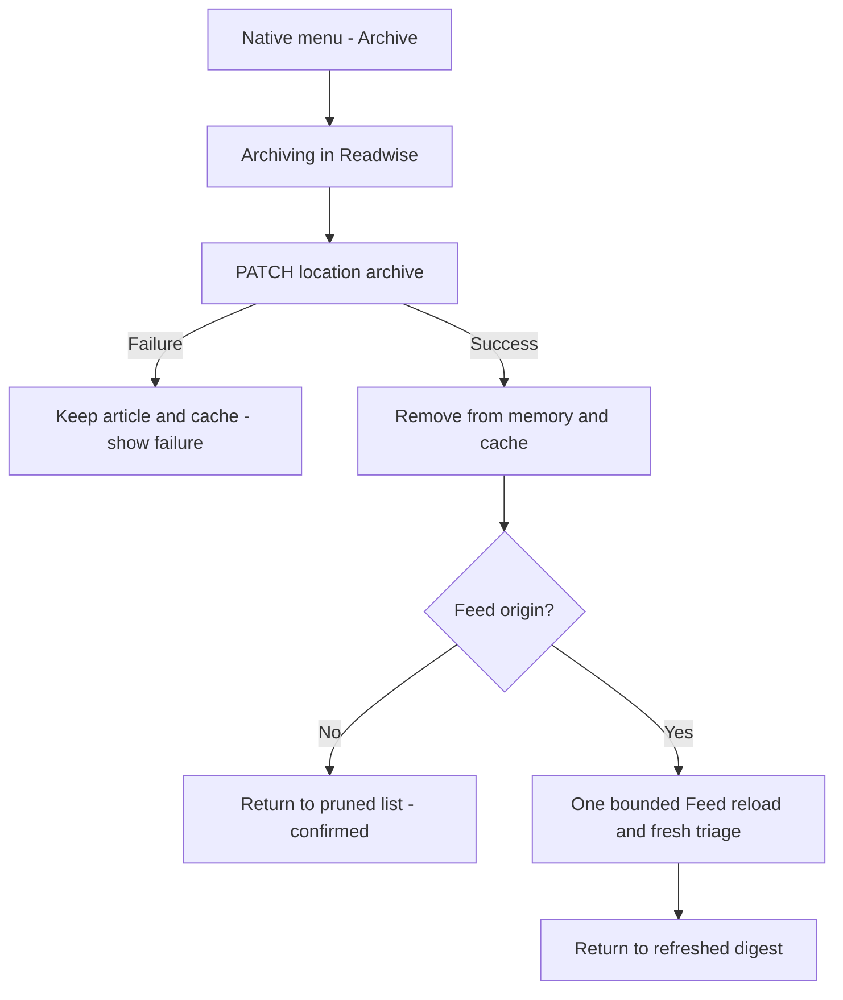

# Readwise Home overview and archive refresh

Target release: 0.3.3.

## Home

Home is a zero-network status overview. It shows sync health/time, loaded article count, saved-today count, in-progress count, and Feed state. Navigation remains in the native contextual menu.

## Archive flow

The remote HTTP success is the commit boundary. Failed writes no longer cause optimistic local disappearance. Feed refresh is caused only by the explicit archive action; no polling or background work is added.

The just-archived ID is also excluded during the refresh so a brief Reader indexing delay cannot reintroduce it. Implemented as Readwise 0.3.3; simulator success and forced-failure behavior are verified, while real G2 acceptance remains open.
