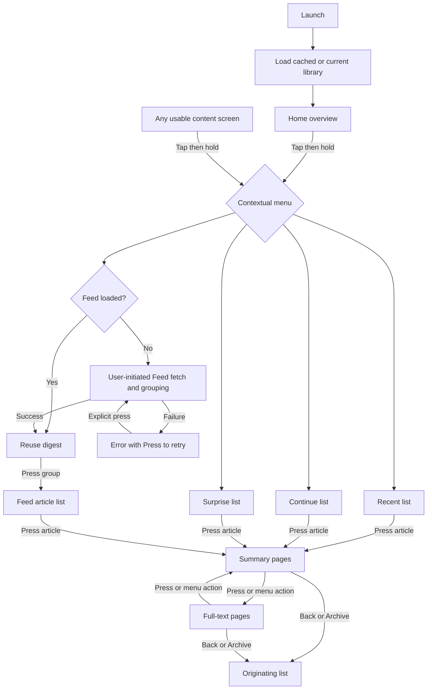

# Readwise G2 contextual menu navigation

This design moves Readwise navigation from an in-canvas home list to the Even OS contextual menu. It targets Readwise 0.3.2 and uses the official [Contextual Menu](https://hub.evenrealities.com/docs/build/contextual-menu) capability. The app already meets its SDK 0.0.14 and Even App 2.2.9 minimums.

## Decision

The contextual menu is the app-wide section switcher. Home becomes an overview that teaches the menu gesture. Every usable content screen carries a menu, allowing a direct switch between Recent, Continue, Feed, and Surprise without backing through Home.

Existing content layouts stay intact: full-width bordered article cards, explicit long-title continuation, paged summaries, Readwise metadata, and the full reader.

## Screen and menu structure

| Screen | Direct interaction | Contextual menu |
|---|---|---|
| Home | Double tap exits via the system dialog | Recent, Continue, Feed, Surprise |
| Recent / Continue / Surprise | Swipe focus; tap article | Other three sections |
| Feed digest | Swipe focus; tap group | Recent, Continue, Surprise |
| Feed group | Swipe focus; tap article | Recent, Continue, Surprise |
| Summary | Swipe pages; tap full text | Read article, Archive, Back, then other sections |
| Reader | Swipe pages; tap summary | Show summary, Archive, Back, then other sections |

The current section is omitted. Article-local actions appear before global section shortcuts.

## Flow chart

## Runtime rules

- Stable app menu IDs are 1–4 for article actions and 101–104 for sections.
- Labels remain within the 32-byte SDK limit.
- The whole menu is supplied on each rebuild because SDK rebuilds replace menu state.
- `menuItemClickEvent.itemID` becomes a pure reducer gesture; unknown IDs are ignored.
- Contextual-menu lifecycle events do not reset route or loaded data.
- Feed remains lazy, is reused within the session, and retries only after explicit input.
- No polling, prefetching, or menu-driven background refresh is added.

## Implementation

- `src/glass/screens.ts`: menu composition and ID decoding.
- `src/glass/nav.ts`: section destinations and route/effect transitions.
- `src/main.ts`: SDK menu rendering and click wiring.
- `src/glass/screens.test.ts`: menu structure, IDs, and firmware budgets.
- `src/glass/nav.test.ts`: global navigation and lazy Feed states.

## Acceptance

Local tests, build, simulator menu selection, and a local package are engineering gates. Real G2 validation of the native gesture, selection routing, foreground return, and legibility is a separate acceptance gate. This work does not authorize upload, publication, push, commit, PR, merge, or deployment.
